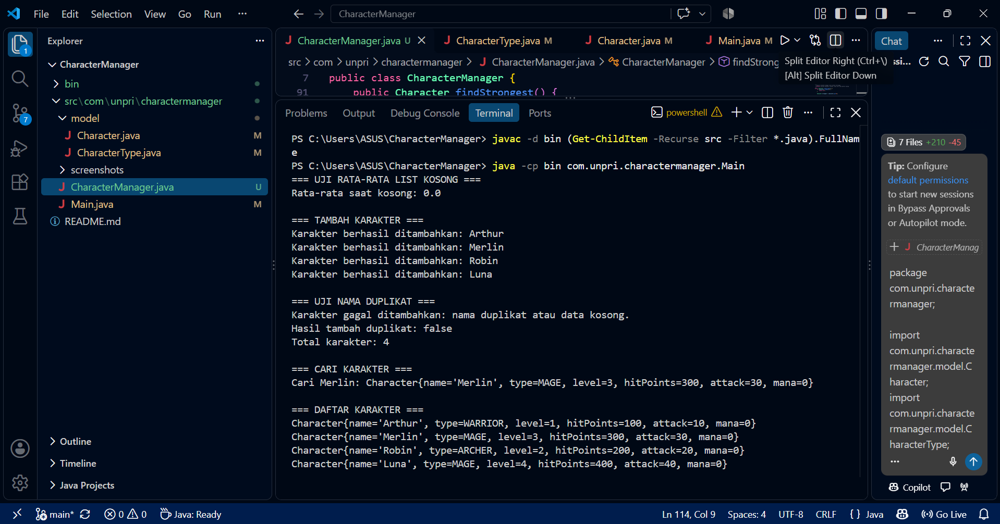
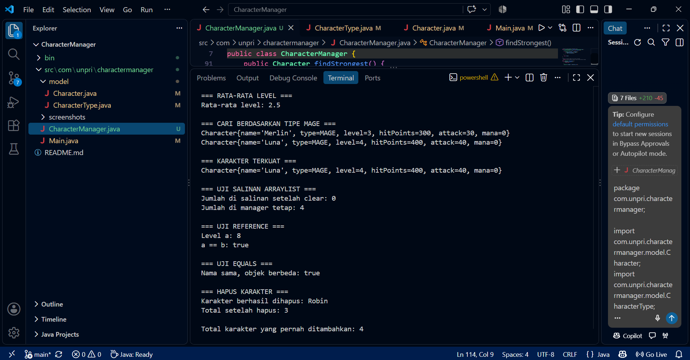

# Character Manager — TP5

## Deskripsi

Program Character Manager dibuat menggunakan Java untuk mengelola data karakter. Pada TP5, program dikembangkan dengan menambahkan fitur pengelolaan karakter, pencarian, penghapusan, serta analisis data karakter.

## Fitur TP5

- `addCharacter()` untuk menambahkan karakter dan menolak nama duplikat.
- `findByName()` untuk mencari karakter berdasarkan nama.
- `removeCharacter()` untuk menghapus karakter.
- `getTotalCharacters()` untuk menghitung jumlah karakter yang tersimpan.
- `getAllCharacters()` untuk mendapatkan salinan daftar karakter.
- `getAverageLevel()` untuk menghitung rata-rata level karakter.
- `findByType()` untuk mencari karakter berdasarkan tipe.
- `findStrongest()` untuk mencari karakter dengan nilai attack tertinggi.

## Screenshot Output

**Output pengelolaan karakter**

**Output eksperimen reference**

## Fitur Analitik

Method `findStrongest()` digunakan untuk mencari karakter dengan nilai attack tertinggi. Fitur ini membantu membandingkan kekuatan serangan karakter yang tersimpan.

## Analisis Reference dan Rancangan

Dokumen analisis membahas reference pada objek Java, perbedaan reference dengan tipe data primitif, penggunaan `static`, method `equals()`, dan pentingnya mengembalikan salinan daftar karakter.

Link Google Docs TP5: https://docs.google.com/document/d/1hDeDd1LbydfVmSO68xuhlgy8NQ0NPCIgeXcDf-wmU8E/edit?usp=sharing

